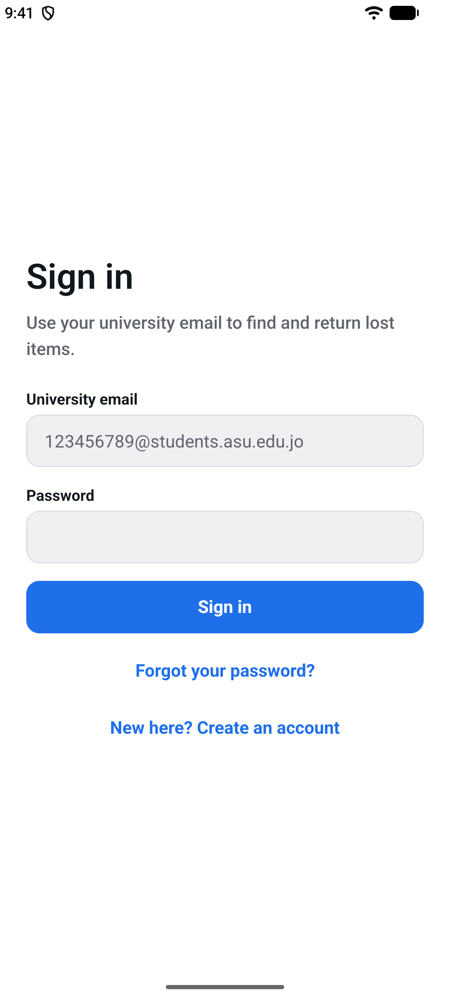
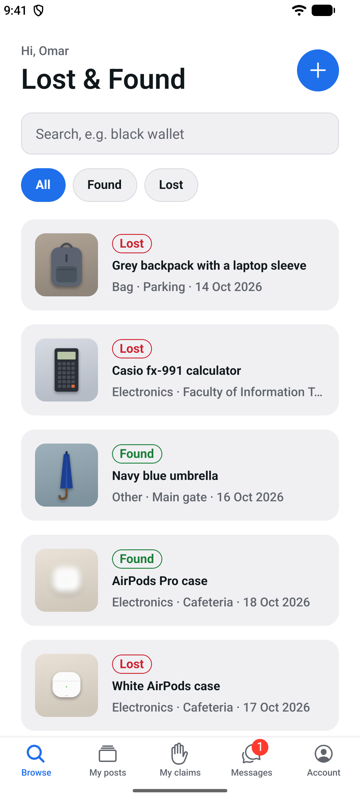
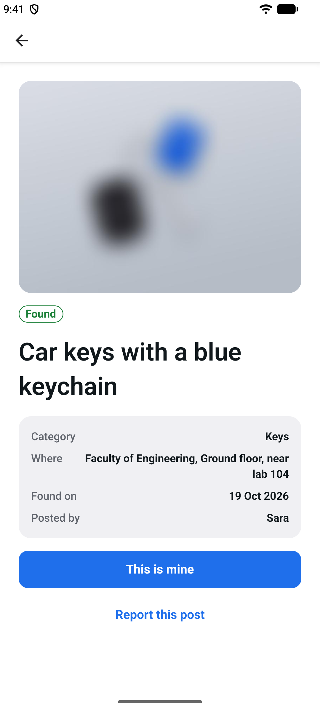
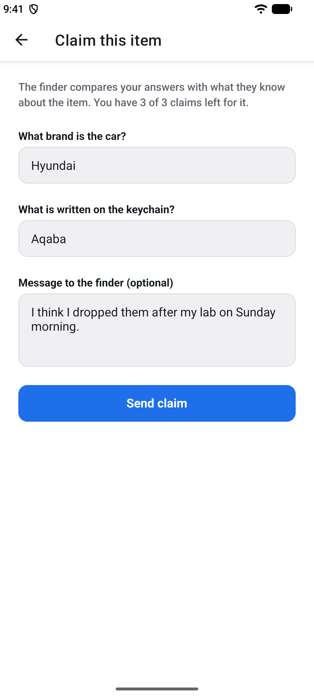
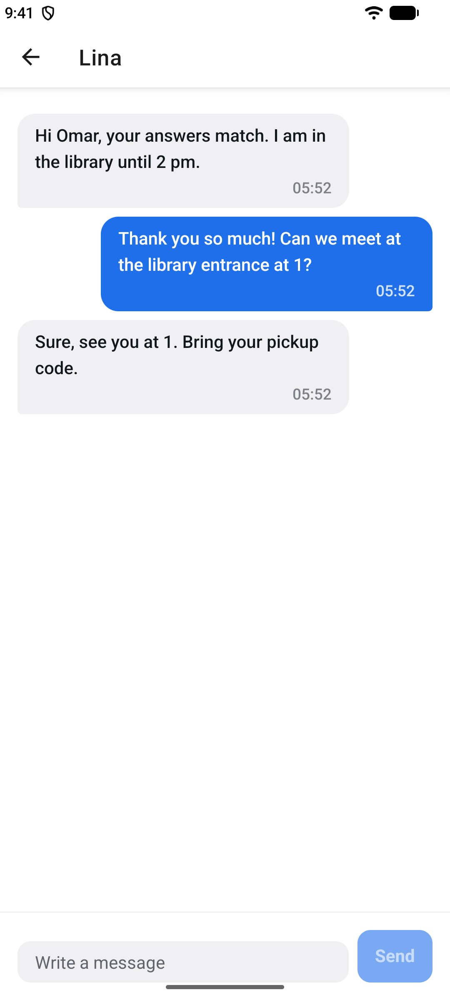
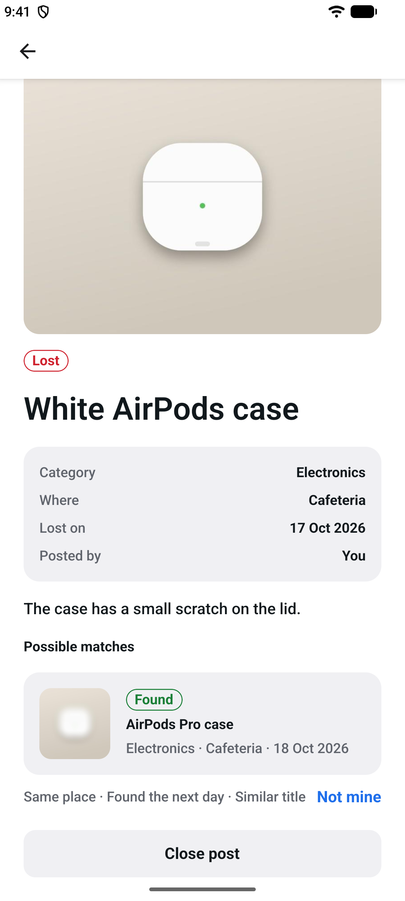
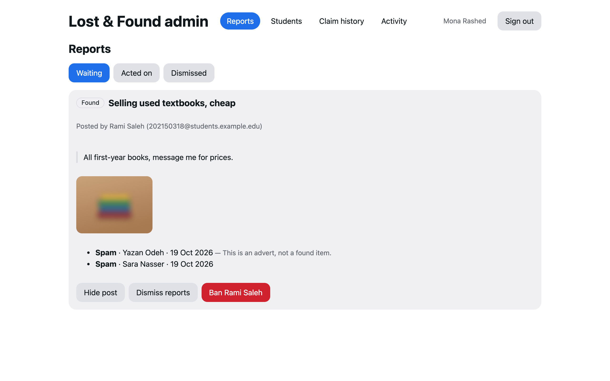
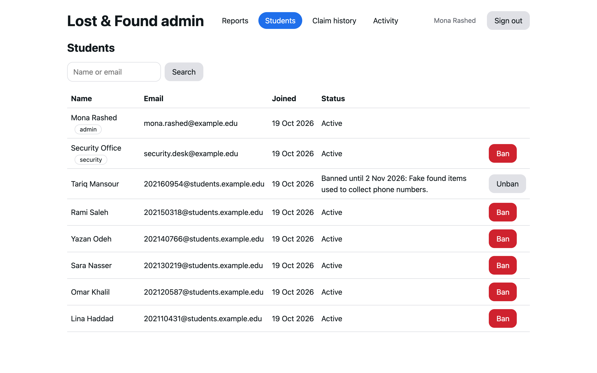
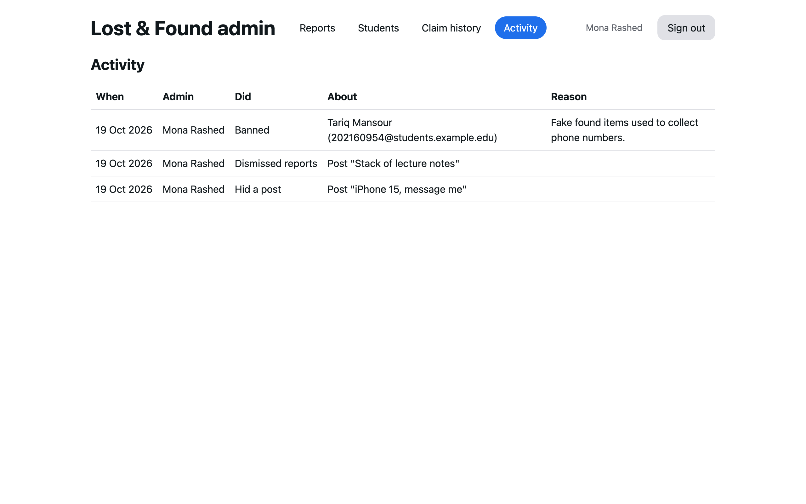

# ASU Lost & Found

A mobile app that helps students at Applied Science Private University get lost items back. Students post what they lost or found on campus, the app suggests matches between the two, and the real owner proves an item is theirs before it is handed over.

## How it works

1. A student finds a black wallet near the library and posts it with a blurred photo and the place on campus.
2. The finder adds private details only the owner would know, such as what is inside or a sticker on it. These are never shown publicly.
3. The owner sees the post (or gets it suggested after posting their own "Lost" post) and answers the finder's questions.
4. The finder accepts or rejects the claim. Valuable items go to the university security office, and the owner picks them up there with their student ID.

## Screenshots

From the app on Android and the admin website, with the demo data below.

| | | |
| :---: | :---: | :---: |
|  |  |  |
| Sign in | Browse | A found item, photo blurred |
|  |  |  |
| Claim with the finder's questions | Arranging the handover | Possible matches |
|  |  |  |
| Admin: reports | Admin: students and bans | Admin: activity log |

## Features

- Project setup: API, database, mobile app, Docker, CI
- Accounts with university email only, email verification, roles (student, security office, admin)
- Lost and found posts with photos (blurred publicly, EXIF removed) and campus locations
- Ownership claims with private questions, limited attempts and claim history
- Handover: in-app messages, pickup code, security office desk
- Match suggestions between lost and found posts
- Moderation: reports, hidden posts, banned accounts, and an admin website
- Account settings: system, light or dark look, changing the email, deleting the account, and Microsoft sign-in with the university account

## Tech stack

| Part | Tools |
| --- | --- |
| Mobile app | React Native, Expo SDK 58, TypeScript, Expo Router, TanStack Query |
| Admin website | React 19, Vite, TypeScript, React Router, TanStack Query, served by nginx |
| API | Node.js 24, NestJS 12, TypeScript, Prisma 7 |
| Database | PostgreSQL 17 |
| Tests | Vitest, Supertest, Testcontainers (backend); Jest, React Native Testing Library (app) |
| Tooling | Docker Compose, GitHub Actions, gitleaks |

## Project structure

```
asu-lost-and-found/
├── backend/                 NestJS API
│   ├── prisma/              schema and SQL migrations
│   ├── src/
│   │   ├── account/         changing the email, deleting the account
│   │   ├── auth/            sign-up, email codes, sign-in (also with Microsoft), tokens, guards
│   │   ├── claims/          ownership claims, answers, claim history
│   │   ├── handovers/       messages, pickup codes, the security office desk
│   │   ├── matches/         suggestions between lost and found posts
│   │   ├── moderation/      reports, hidden posts and messages, bans
│   │   ├── cli/             set-role and demo data commands
│   │   ├── config/          environment validation
│   │   ├── health/          GET /api/health
│   │   ├── mail/            email outbox and SMTP sender
│   │   ├── photos/          resizing, blurring and serving photos
│   │   ├── places/          campus places
│   │   ├── posts/           lost and found posts, search
│   │   ├── prisma/          database client
│   │   ├── rate-limit/      request limits
│   │   ├── storage/         file storage (a Docker volume, swappable)
│   │   └── users/           profiles and roles
│   └── test/                integration tests on a real PostgreSQL
├── admin/                   admin website (React): reports, students, claim history, activity
├── mobile/                  Expo app
│   └── src/
│       ├── api/             API client with automatic token refresh
│       ├── app/             screens (Expo Router): sign-in screens, then Browse, My posts, My claims, Messages and Account tabs (and Desk for security staff)
│       ├── components/      form fields, buttons, screen layout
│       ├── hooks/           theme colours, the system, light or dark choice, search delay
│       ├── session/         signed-in state, token storage, Microsoft sign-in
│       └── test/
├── docker/postgres/         database setup script
├── docs/screenshots/        README screenshots
├── docker-compose.yml
└── .github/workflows/ci.yml
```

## Run it locally

You need Docker, Node.js 24 or newer, and an Android emulator (or a phone with Expo Go).

### 1. API and database

```bash
cp .env.example .env
```

Set `DB_ADMIN_PASSWORD`, `DB_PASSWORD` and `DB_APP_PASSWORD` in `.env`, each to a different output of `openssl rand -hex 24`, and `JWT_SECRET` and `SERIAL_HASH_KEY` each to a different output of `openssl rand -base64 48`. Then:

```bash
docker compose up -d --build
```

The API answers at http://localhost:4000/api/health with `{"status":"ok","database":"up"}`. Emails (verification and password reset codes) go to the Mailpit inbox at http://localhost:8027 until you point the `MAIL_*` settings at a real SMTP server.

### Demo data

On an empty local database, one command creates demo students, a security office account and an admin, posts with drawn item photos, a claim with a chat, a match, an item at the security desk, reports and a ban. Set `DEMO_PASSWORD` in `.env` first (at least 16 characters; every demo account uses it), then:

```bash
docker compose --profile demo run --rm seed
```

The demo accounts use made-up `example.edu` addresses, and the command refuses to run when the database already has accounts or when email goes anywhere but Mailpit. Only this one-off `seed` service gets `DEMO_PASSWORD`; the API never sees it. To start over, `docker compose down -v` deletes the local database and photos.

### Making the first admin

Everyone signs up as a student. To give an account another role (`STUDENT`, `SECURITY` or `ADMIN`):

```bash
docker compose exec backend node dist/cli/set-role.js you@asu.edu.jo ADMIN
```

A `SECURITY` account sees a Desk tab in the app, for the university security office.

### The admin website

`docker compose up` also serves the admin website at http://localhost:4001. Sign in with an `ADMIN` account: first the password, then the 6-digit code that arrives in Mailpit. To work on the website itself:

```bash
cd admin
cp .env.example .env
npm install
npm run dev
```

### 2. Mobile app

```bash
cd mobile
cp .env.example .env
npm install
npm run android
```

Create an account with a student email (the 9-digit student number, such as `123456789@students.asu.edu.jo`) or a staff `@asu.edu.jo` address, and read the code in Mailpit. The Android emulator reaches your computer at `10.0.2.2`; for a real phone, put your computer's network address in `mobile/.env` and set `APP_BIND=0.0.0.0` in the root `.env`.

### Microsoft sign-in (optional)

The "Continue with Microsoft" button appears once the app and the API know the university's Microsoft app registration. Students then sign in with their university email and password on Microsoft's own page; the app never sees the password.

1. In the [Microsoft Entra admin center](https://entra.microsoft.com), open **Identity** > **Applications** > **App registrations** and click **New registration**.
2. Name it `ASU Lost & Found`, choose **Accounts in this organizational directory only**, and click **Register**.
3. Open **Authentication** > **Add a platform** > **Mobile and desktop applications**, enter the redirect URI `asulostfound://auth`, and click **Configure**.
4. From **Overview**, copy the **Application (client) ID** and the **Directory (tenant) ID**.
5. Put them in the root `.env` as `MICROSOFT_CLIENT_ID` and `MICROSOFT_TENANT_ID`, and in `mobile/.env` as `EXPO_PUBLIC_MICROSOFT_CLIENT_ID` and `EXPO_PUBLIC_MICROSOFT_TENANT_ID`, then run `docker compose up -d --build` again.

Registering an app in the university's directory needs the university IT department's permission. Try it with a real university account first: the API refuses guests from other organisations, and a directory that signs its own members in through another identity provider could look like that. Expo Go can't receive `asulostfound://auth`, so try Microsoft sign-in in a development build (`npx expo run:android`).

### Running the API outside Docker

With only the database running (`docker compose up -d db`), copy `backend/.env.example` to `backend/.env`, fill in the passwords, `JWT_SECRET` and the same `SERIAL_HASH_KEY` as in the root `.env`, and run:

```bash
cd backend
npm install
npm run db:migrate
npm run start:dev
```

## API

All routes start with `/api`. Everything except the ones marked public needs `Authorization: Bearer <access token>`.

| Method and path | Public | What it does |
| --- | --- | --- |
| `POST /auth/register` | yes | Create an account with a university email; emails a 6-digit code |
| `POST /auth/resend-code` | yes | Send a new verification code (at most one a minute) |
| `POST /auth/verify-email` | yes | Email, password and code; verifies the email and signs in |
| `POST /auth/login` | yes | Returns an access token (15 minutes) and a refresh token (30 days). Security office accounts first get a 6-digit code by email and send it with the password |
| `POST /auth/refresh` | yes | Swaps a refresh token for a new pair |
| `POST /auth/logout` | yes | Ends the sign-in that the refresh token belongs to |
| `POST /auth/microsoft/start` | yes | A one-time value for the app to send to Microsoft (works once, for 10 minutes) |
| `POST /auth/microsoft` | yes | Signs in with the ID token Microsoft gave back; creates the account on the first sign-in |
| `POST /auth/forgot-password` | yes | Emails a password reset code |
| `POST /auth/reset-password` | yes | Sets a new password with the code and signs out every device |
| `GET /users/me` | no | The signed-in user's profile |
| `POST /users/me/confirmation-code` | no | Emails a 6-digit code that stands in for the password on accounts that sign in with Microsoft only |
| `POST /users/me/email` | no | Start changing the email: the new address plus the password (or that code); emails a code to the new address if it is free |
| `POST /users/me/email/confirm` | no | The code from the new address; moves the account and signs out other devices |
| `DELETE /users/me` | no | Delete the account with the password (or the code): erases the name and email and keeps the history without them |
| `GET /places` | no | Campus places to choose from |
| `GET /posts` | no | Open posts, newest first; filters `type`, `category`, `placeId`, search `q`, paging with `cursor` and `limit` |
| `GET /posts/mine` | no | The signed-in student's posts, closed ones included |
| `GET /posts/:id` | no | One post (a closed post only for its author) |
| `POST /posts` | no | Create a post: form fields plus up to 4 photos (`multipart/form-data`); a found item also needs 1 to 3 questions for the owner |
| `PATCH /posts/:id` | no | Edit your own open post |
| `POST /posts/:id/close` | no | Close your own post |
| `GET /photos/:id` | no | The photo other students see (blurred for found items) |
| `GET /photos/:id/original` | no | The unblurred photo, only for the student who posted it or whose claim was accepted |
| `GET /posts/:id/claim-form` | no | The finder's questions, whether a serial number is needed, claims left and your own claim |
| `POST /posts/:id/claims` | no | Claim a found item by answering its questions |
| `GET /posts/:id/claims` | no | For the finder: their private notes and every claim on the item |
| `POST /claims/:id/accept` | no | Accept a claim; the item is marked claimed and the other waiting claims are closed |
| `POST /claims/:id/reject` | no | Reject a claim |
| `POST /claims/:id/withdraw` | no | Take back your own claim while it is waiting |
| `GET /claims/mine` | no | The signed-in student's claims |
| `GET /admin/claimants` | no | Admin only: students with their rejected and total claims |
| `GET /handovers/mine` | no | The signed-in student's handovers with the last message and unread count |
| `GET /posts/:id/handover` | no | For the finder and the owner: the handover; the owner also sees the pickup code |
| `GET /posts/:id/messages` | no | The finder's and the owner's messages, oldest first; marks them read |
| `POST /posts/:id/messages` | no | Send a message (until the item is handed over) |
| `POST /posts/:id/handover/return` | no | The finder, or the security office for items it holds, types the owner's code; the item becomes returned |
| `POST /posts/:id/handover/new-code` | no | The owner replaces a code that was locked after 5 wrong tries |
| `POST /posts/:id/desk` / `DELETE /posts/:id/desk` | no | The finder takes a found item to the security office, or changes their mind before it arrives |
| `GET /desk/items?status=` | no | Security staff only: items on the way to the desk, or at the desk |
| `POST /desk/items/:id/receive` | no | Security staff only: the desk has the item |
| `GET /posts/:id/matches` | no | For the author of a lost post: found items that may be theirs, with the reasons |
| `POST /posts/:id/matches/:foundId/dismiss` | no | Hide a suggested found item ("Not mine") |
| `POST /posts/:id/reports` / `POST /messages/:id/reports` | no | Report a post, or a message sent to you, with a reason |
| `POST /admin/auth/login` | yes | Admin website, step 1: password; emails a 6-digit code |
| `POST /admin/auth/verify` | yes | Step 2: the code; returns an access token and sets the refresh cookie |
| `POST /admin/auth/refresh` / `POST /admin/auth/logout` | yes | Uses the httpOnly cookie; only from the admin website |
| `GET /admin/reports?status=` | no | Admin: reports grouped by post or message |
| `POST /admin/posts/:id/hide` / `restore` | no | Admin: hide a post from everyone but its author, or show it again |
| `POST /admin/messages/:id/remove` | no | Admin: remove a message from a chat |
| `POST /admin/posts/:id/reports/dismiss` / `POST /admin/messages/:id/reports/dismiss` | no | Admin: close reports without a change |
| `GET /admin/users?q=` | no | Admin: find students by name or email |
| `POST /admin/users/:id/ban` / `unban` | no | Admin: ban (with a reason, for some days or for good) or lift a ban |
| `GET /admin/log` | no | Admin: every moderation decision and the admin who made it |
| `GET /health` | yes | API and database status |

## Tests

| Command | Folder | What it runs |
| --- | --- | --- |
| `npm test` | `backend/` | Unit tests |
| `npm run test:e2e` | `backend/` | API tests against PostgreSQL 17 in Docker (Testcontainers) |
| `npm run lint` / `npm run typecheck` | `backend/`, `mobile/`, `admin/` | oxlint or ESLint, TypeScript |
| `npm test` | `mobile/` | Sign-in (also with Microsoft), posting, claim, handover, matching, reporting and account settings flows on the real screens, API client and token refresh |
| `npm test` | `admin/` | Admin website: sign-in in two steps, the report queue, bans and the claim history |

GitHub Actions runs all of them on every pull request, plus a gitleaks secret scan and a Docker build that starts the whole stack and calls the health endpoint.

## Security

- Three database logins: the `postgres` superuser only creates the database, `lostfound` owns it and runs the migrations, and the API connects as `lostfound_app`, which can read and write rows but cannot create, change or drop tables. Neither of the last two is a superuser; integration tests check all of this.
- Only university emails can sign up: students with their 9-digit student number at `students.asu.edu.jo`, staff at `asu.edu.jo` (both set in `.env`). An account works only after the emailed 6-digit code is entered. Codes are stored as a keyed hash (HMAC), so a copy of the table can't be turned back into codes, expire after 15 minutes and allow 5 tries. Each account gets at most 5 codes and 15 wrong guesses a day, so asking for new codes doesn't give an attacker more tries.
- Verifying an email needs the password as well as the code, so nobody can sign up with someone else's email first and take the account over once the real owner verifies it.
- Passwords hashed with bcrypt (cost 12). Sign-in gives the same answer for a wrong password and an unknown email, and takes the same time. Sign-up, resending a code and password reset give the same answer whether or not an email has an account. Emails never include text typed into the sign-up form, and names may only contain letters, spaces, apostrophes, dots and hyphens.
- Microsoft sign-in uses the authorization code flow with PKCE in the system browser, so the app never sees the university password. The API checks the ID token itself: Microsoft's signature, that it was made for this app, that it belongs to a member of the university's tenant (guests from other organisations are refused), and that it carries a one-time value the API handed out a few minutes before. That value works once, so a copied ID token can't sign in again. The email still has to follow the student or staff rule. An account is linked by Microsoft's tenant and object ID, never by the email alone once it is linked, and the owner of an existing account gets an email when Microsoft is added to it. If an unconfirmed sign-up used the same email, it loses its password and name, since Microsoft has proved who owns the email. Accounts made with Microsoft have no password, and no password works for them.
- Changing the email needs the password (or a code to the current email for Microsoft-only accounts) and then a code sent to the new address. The answer is the same whether or not the new address already has an account, and only a free address gets the code (a sign-up nobody confirmed doesn't count, and gives the address up). Asking again for a different address waits for a new code, also when two requests arrive at the same moment, so an old code can never confirm an address it wasn't sent to. Afterwards every other device is signed out, the old address gets a notice, and the Microsoft link is removed; the next Microsoft sign-in with the new address links it again.
- Deleting an account needs the same proof. The name, email, password and Microsoft link are erased and the student is signed out everywhere; claims, reports and chats stay without a name. A database check makes sure a deleted account can't sign in. Instead of the email, the deleted account keeps a keyed hash of it (with `SERIAL_HASH_KEY`), so signing up again with the same email doesn't give new claims on an item. Banned accounts, admins and students in the middle of a handover can't delete their account; this is checked again with the account and its posts locked, so a claim accepted at the same moment can't slip through. Admins can't find or ban a deleted account.
- Short-lived access tokens (JWT, HS256) and refresh tokens that work once: each refresh replaces the token, and reusing an old one ends that whole sign-in. Refresh tokens are stored hashed. Changing the password signs out every device and ends access tokens issued before it. In the app the refresh token lives in the device's secure storage.
- Every route needs a signed-in user unless it is marked public, and the user is checked against the database on every request. Roles are checked by a guard; extra fields such as `role` in a sign-up request are refused.
- Rate limits: 10 requests an hour that send an email (claims included) and 10 password or code attempts every 15 minutes per account, and 5 posts with photos a minute per student (all set in `.env`). Before sign-in an account is the email the request names, so guessing one student's password from many addresses still stops at 10; one network address gets ten times as much, so a whole campus behind one address keeps working. Once signed in, requests are counted per student. Starting a Microsoft sign-in is limited to 20 a minute per address.
- Emails go through an outbox table in the same transaction as the change that triggers them, and are retried with backoff if the mail server is down. An email with a code is dropped once the code expires, emails that failed are deleted after a week, and deleting an account removes everything still queued for its address.
- Photos: every upload is decoded and saved again as a new JPEG, so only real JPEG, PNG or WebP images are accepted and all EXIF data (GPS position, phone model) is removed. At most 4 photos of 8 MB each per post, and 10 posts a day per student, also when many arrive at the same moment.
- Uploads can't overload the server: each photo's header is checked before it is decoded (at most 25 megapixels, no 16-bit or animated images), photos are processed one at a time with at most two jobs running across the whole server, and the backend container has a memory limit. The app shrinks photos on the phone before uploading them.
- Found items are shown blurred to everyone except the student who posted them, so only the real owner can describe the details. Originals are only ever sent to the poster and, once a claim is accepted, to that claimant. Photos are fetched by id through the API after the sign-in check; file names on disk are random and never leave the server.
- A post that is closed disappears for everyone but its author, photos included. Editing or closing someone else's post answers 404, as if it didn't exist.
- Claims: claimers answer the finder's questions without seeing the private notes, and only the finder sees the answers next to the notes. Someone else's claim answers 404. A student gets 3 claims per item, and a withdrawn claim counts like a rejected one, so withdrawing and claiming again can't flood the finder with emails. Withdrawn claims disappear from the finder's list. New claims and decisions on one item wait for each other, and the database allows one waiting claim per student per item and one accepted claim per item, so two accepts at the same moment can't both win. Claim emails never include the answers or the notes.
- Serial numbers and IMEIs are never stored as typed: the server keeps an HMAC-SHA256 fingerprint made with a secret key from `.env` (`SERIAL_HASH_KEY`), so a copy of the database alone can't be used to work them out. It compares that with the claimer's number, and only the finder learns whether it matched.
- Handover: only the finder and the student whose claim was accepted can read the chat or the handover; anyone else gets 404. The pickup code is shown only to the owner, and only the person holding the item can type it: the finder, or security staff once the item is at the desk (never for their own item). 5 wrong codes lock it until the owner asks for a new one, even when guesses arrive at the same moment, and code attempts count toward the password and code rate limit. Message emails never include the text and go out at most once an hour per chat, only to someone who hasn't had it open for 5 minutes and has opened it since the last email.
- The security office sees the finder's name and email, the owner's full name once it has the item (to check the student ID at pickup), and the original photos of items it is handling. Only accounts with the security role can open the desk, and they sign in with the password and then a code sent by email (or through Microsoft). Giving an account a new role signs it out everywhere, so a student made security staff starts with that two-step sign-in. Security accounts can't claim items, since they see desk items unblurred.
- Admin website: the password and then a code sent by email. Admin endpoints only accept tokens from that sign-in, so an admin's password alone, typed into the app, can't moderate. The refresh token lives in an httpOnly, SameSite=Strict cookie scoped to the sign-in endpoints, and refreshing also needs the admin site's origin and a custom header. CORS allows the admin website only. The cookie lasts until the browser closes, and an admin session ends 12 hours after sign-in however often it refreshes, or as soon as the account stops being an admin.
- The admin website is served by nginx running as a non-root user, with a Content-Security-Policy that allows scripts only from the site itself and network calls only to the API.
- Reports: a student can report a post they can see, or a message sent to them, once each, and 20 reports an hour. Admins see only the reported message, never the rest of the chat.
- A ban signs the student out everywhere, blocks sign-in until its end date (or for good), hides their open posts and closes their waiting claims. The student gets an email with the reason. Admin accounts can't be banned.
- Hiding a post closes its waiting claims, and a moderator's hiding stays after a ban on the author ends. Every moderation decision is written to a log, with the admin who made it, in the same transaction as the decision.
- Match suggestions are shown only to the author of the lost post, with the same blurred photos as Browse. The match email names only the student's own lost item. It goes out only when the titles themselves are alike, to at most 3 students per found item, and nobody gets more than one a day.
- The database never removes a student or an item that has claims, so the claim history and the 3-claims limit can't be reset. Closing a found item closes its waiting claims and emails those claimants.
- Emails to a real mail server must use TLS; only the local Mailpit inbox is allowed plain SMTP.
- Configuration comes from environment variables and is validated at startup. Secrets live only in git-ignored `.env` files; the repository has `.env.example` copies.
- Post titles can't contain web or email addresses, because emails to other students quote them.
- The admin website must be on HTTPS unless it runs on this machine, so its refresh cookie is always marked Secure. A release build of the app refuses an API address that isn't `https://`.
- The demo data command runs only as a one-off `seed` service, on an empty database whose email goes to Mailpit; the running API never gets `DEMO_PASSWORD`, and the demo accounts use made-up `example.edu` addresses.
- Security headers through Helmet, request bodies validated and stripped of unknown fields.
- The database and API ports listen on this machine only unless `APP_BIND` says otherwise.
- Docker base images are pinned by digest, and CI checks out code without keeping its GitHub token on disk.
- The Docker images run as a non-root user, and the API image holds only production packages (no Prisma CLI or TypeScript).

## Known limits

- Rate limits are kept in memory, so they assume a single API server. Behind a proxy the API would also need to trust its forwarded address, or every request would count as the proxy's.
- Signing up again with an email that is still waiting for verification replaces the password, so someone who knows a classmate is signing up can make the classmate's code fail until they sign up once more. It can't be used to take the account over, because verifying needs the password together with the emailed code.
- Response times of the password reset and resend-code endpoints differ by a few milliseconds between existing and unknown emails.
- Messages arrive by asking the server every few seconds while a chat is open, not instantly, and there are no push notifications; emails stand in for them.
- Matching compares spelling, not meaning: "purse" and "wallet" don't count as similar titles, although the category, place and date still bring such items up.
- The admin website's second step is a code sent to the admin's email, the same inbox that can reset the password, so someone who controls that inbox has both steps. An authenticator app for admins would close this.
- A timed ban ends at the student's next sign-in after its end date; until then their posts stay hidden.
- The claim limit links a deleted account to a new one by email only. Someone with two university addresses who moves an account from one to the other, before deleting it or after signing up again, starts with fresh claims. The same goes for a Microsoft student who moves the account to another address: their next Microsoft sign-in makes a second account.
- An item left at the security office that nobody claims stays listed at the desk; there is no step yet to give it back to the finder or dispose of it.

## Author

Malik · Faculty of IT, Applied Science Private University, Amman

## License

[MIT](LICENSE)
